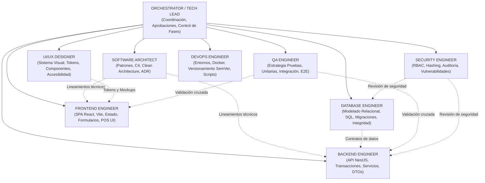

# PROTOCOLO DE COLABORACION MULTIAGENTE — TRIANGLE
## ORGANIZACION, ROLES, RESPONSABILIDADES Y CONTROL DE INTEGRACION

**Versión:** 1.0.0  
**Proyecto:** TRIANGLE ERP / POS  
**Organización:** Tienda de Barrio S.A.S.  

---

## 1. EQUIPO MULTIAGENTE DE INGENIERÍA DE SOFTWARE

El desarrollo de TRIANGLE se gestiona bajo una metodología de ingeniería multiagente especializada, coordinada centralizadamente por el Technical Lead / Orchestrator. Cada rol cuenta con límites de actuación precisos, responsabilidades definidas y criterios de revisión obligatorios.

---

## 2. ROLES Y RESPONSABILIDADES

### 2.1. Agente Principal: ORCHESTRATOR / TECH LEAD
- **Misión:** Coordinar las fases, distribuir tareas delimitadas, resolver conflictos técnicos y gobernar la integración de código.
- **Autoridad:** Es el **único rol autorizado** para consolidar entregables de fase, validar criterios de aceptación y solicitar la aprobación formal del usuario.
- **Regla rectora:** Ninguna fase avanza sin la aprobación explícita y documentada del usuario.

### 2.2. Agente de Arquitectura: SOFTWARE ARCHITECT
- **Misión:** Diseñar la arquitectura general del sistema, garantizar principios SOLID, Clean Architecture y modularidad estricta.
- **Entregables:** Diagramas C4, contratos entre capas, Architectural Decision Records (ADRs en `docs/DECISIONS/`).
- **Límite:** No modifica unilateralmente los requisitos del negocio ni introduce dependencias pesadas sin justificación técnica documentada.

### 2.3. Agente de Base de Datos: DATABASE ENGINEER
- **Misión:** Modelado relacional normalizado en PostgreSQL 18, integridad referencial, índices de alto rendimiento y scripts SQL canónicos.
- **Entregables:** `database/schema.sql`, `database/seed.sql`, `database/init.sql`, migraciones tipadas de ORM y documentación en `docs/DATABASE.md`.
- **Límite:** Prohibido el uso de tipos `FLOAT` para dinero (`NUMERIC(14,2)` obligatorio) y prohibida la eliminación física de registros con histórico transaccional.

### 2.4. Agente Backend: BACKEND ENGINEER
- **Misión:** Construcción de la API REST modular en NestJS + TypeScript, servicios de dominio, control transaccional ACID y validación de DTOs.
- **Entregables:** Controladores, servicios, módulos NestJS, repositorios desacoplados, filtros de excepción y pruebas unitarias/integración.
- **Límite:** Todo cambio transaccional en ventas e inventario debe ser atómico y respetar las restricciones de negocio.

### 2.5. Agente Frontend: FRONTEND ENGINEER
- **Misión:** Construcción de la aplicación web SPA con React 19 + TypeScript + Vite + Tailwind CSS.
- **Entregables:** Componentes modulares, terminal POS optimizada para atajos de teclado (`F2`, `F10`), consumo de API vía TanStack Query, validaciones visuales y formularios reactivos.
- **Límite:** El frontend jamás se conecta directamente a la base de datos ni ejecuta cálculos financieros definitivos; siempre delega al backend como autoridad.

### 2.6. Agente de Diseño: UI/UX DESIGNER
- **Misión:** Salvaguardar la identidad visual de TRIANGLE (estética nórdica/fintech inspirada en Paymen adaptada a tiendas de barrio de Bogotá).
- **Entregables:** `DESIGN.md`, especificación de componentes reutilizables, paleta de colores, sombras ambientales y tipografía Inter.
- **Límite:** Evitar interfaces genéricas, bordes duros no armónicos y garantizar contraste de accesibilidad WCAG AA.

### 2.7. Agente QA: QUALITY ASSURANCE ENGINEER
- **Misión:** Garantizar la calidad funcional y no funcional mediante pruebas automatizadas y verificación de criterios de aceptación.
- **Entregables:** Matriz de pruebas unitarias, de integración y E2E (Playwright/Vitest), `docs/QA_REPORT.md` y medición de cobertura (mínimo 80% global, 90% en lógica crítica).
- **Límite:** Prohibido desactivar tests o saltarse validaciones para forzar la aprobación de un build.

### 2.8. Agente de Seguridad: SECURITY ENGINEER
- **Misión:** Proteger la autenticación, autorización RBAC, sanitización de entradas, hashing criptográfico de contraseñas y auditoría inmutable.
- **Entregables:** `docs/SECURITY.md`, análisis de vulnerabilidades OWASP Top 10, políticas de contraseñas y bitácora de auditoría.
- **Límite:** Prohibido almacenar datos sensibles de tarjetas (número completo, CVV) y prohibido exponer secretos en repositorios.

### 2.9. Agente DevOps: DEVOPS ENGINEER
- **Misión:** Configuración de entornos de ejecución, scripts de inicialización, control de versiones semánticas y automatización.
- **Entregables:** `VERSION`, `CHANGELOG.md`, `.env.example`, `.gitignore`, scripts de respaldo de base de datos y documentación de despliegue en `docs/DEPLOYMENT.md`.

---

## 3. PROTOCOLO DE COLABORACIÓN E INTEGRACIÓN

1. **Recepción de Tarea Delimitada:** Cada agente recibe su asignación con referencia directa a una Historia de Usuario (`US-XXX`).
2. **Creación de Rama de Trabajo:** La rama debe respetar la convención `feat/US-{ID}-{slug}` o `fix/US-{ID}-{slug}`.
3. **Desarrollo Orientado a Pruebas (TDD):** Implementación de código acompañada de sus respectivas pruebas unitarias.
4. **Commits Convencionales:** Cada commit debe referenciar el ID de la Historia de Usuario: `feat(US-POS-01): add barcode scan debouncing`.
5. **Revisión Cruzada y Gate del Orchestrator:** Antes de fusionar cambios, el Orchestrator valida compilación limpia, aprobación de pruebas y actualización de la documentación correspondiente.
6. **No Interferencia:** Queda prohibida la modificación simultánea no coordinada de los mismos archivos por diferentes agentes.
