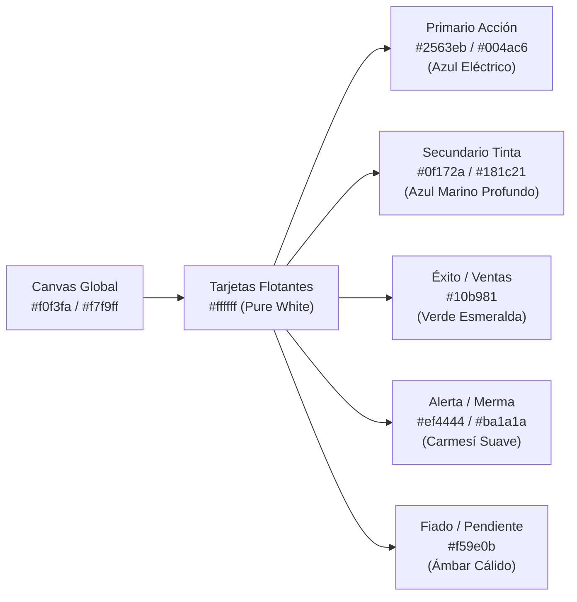

# SISTEMA DE DISEÑO VISUAL Y UI/UX — TRIANGLE SOFT POS
## ESTÉTICA NÓRDICA-FINTECH PARA TIENDAS DE BARRIO EN BOGOTÁ, COLOMBIA

**Versión:** 1.0.0  
**Proyecto:** TRIANGLE ERP / POS  
**Organización:** Tienda de Barrio S.A.S. — Sede Chapinero  
**Fuente canónica de prototipos:** `extracted_resources/stitch_triangle_erp_pos_redesign/`  

---

## 1. FILOSOFÍA VISUAL Y PERSONALIDAD DE MARCA

El sistema visual de **TRIANGLE** está concebido específicamente para transformar la experiencia del tendero y cajero colombiano. Rompe radicalmente con el software POS tradicional (tosco, oscuro, saturado de botones grises y ventanas rígidas) para ofrecer una experiencia **fresca, luminosa, amigable y de alta tecnología**, inspirada en la corriente fintech contemporánea (referencia Paymen).

### 1.1. Pilares de la Experiencia
- **Cercana y Confiable:** Diseñada para personas trabajadoras que necesitan certeza inmediata sobre sus ventas, existencias, arqueos y cuentas por cobrar ("el fiado").
- **Ligera y Luminosa:** Fondos en tintes lavanda-nieve ultra suaves (`#f0f3fa`), tarjetas flotantes blancas inmaculadas (`#ffffff`) y ausencia deliberada de líneas o bordes duros divisorios.
- **Eficiente y Veloz:** Jerarquía visual contundente, permitiendo lecturas al vuelo en el ajetreo del mostrador con soporte pleno para atajos de teclado (`F2`, `F10`, `ESC`).

---

## 2. PALETA DE COLORES Y TOKENS SEMÁNTICOS

### 2.1. Tokens de Color Principales (Tailwind CSS)

| Token | Hex | Uso en la Interfaz |
|---|---|---|
| `background` / `canvas` | `#f0f3fa` / `#f7f9ff` | Lienzo global de la aplicación. Elimina el destello puro de la pantalla y destaca las tarjetas. |
| `surface-container-lowest` | `#ffffff` | Superficie de tarjetas modulares, paneles laterales y modales. |
| `surface-container-low` | `#f1f4fb` | Fondos de inputs, chips inactivos y divisores tonales. |
| `primary` | `#004ac6` | Enfoques y texto interactivo destacado. |
| `primary-container` | `#2563eb` | Botón principal de checkout, cobro rápido, acciones destacadas. |
| `on-primary` | `#ffffff` | Texto y glifos sobre contenedores primarios. |
| `on-surface` | `#0f172a` / `#181c21` | Títulos principales, valores numéricos prominentes y saldos. |
| `on-surface-variant` | `#64748b` / `#434655` | Subtítulos, descripciones secundarias y etiquetas auxiliares. |
| `outline` | `#94a3b8` / `#737686` | Íconos inactivos, placeholders de inputs y bordes sutiles. |
| `success` | `#10b981` | Ventas exitosas, ingresos positivos, caja cuadrada (Fondo `#d1fae5`). |
| `error` | `#ef4444` / `#ba1a1a` | Egresos, anulaciones, faltantes de caja, lotes vencidos (Fondo `#fee2e2`). |
| `warning` | `#f59e0b` | Fiados pendientes, productos por vencer en semáforo medio (Fondo `#fffbeb`). |

---

## 3. TIPOGRAFÍA Y FORMATOS LOCALES COLOMBIANOS

Se adopta la familia tipográfica **Inter** de manera unificada:

### 3.1. Escala Tipográfica
- **`headline-xl`:** 36px | Line-height: 44px | Weight: 800 (Extrabold) | Letter-spacing: -0.02em (Titular de Bienvenida en Dashboard).
- **`headline-lg`:** 28px | Line-height: 36px | Weight: 700 (Bold) (Encabezados de sección y POS).
- **`currency-display`:** 32px | Line-height: 38px | Weight: 800 (Extrabold) | Letter-spacing: -0.03em (Cifras de dinero y totales en caja).
- **`title-sm`:** 16px | Line-height: 24px | Weight: 600 (Semibold) (Títulos de productos y tarjetas KPI).
- **`body-lg`:** 16px | Line-height: 24px | Weight: 400 (Regular) (Inputs principales y textos de lectura).
- **`body-md`:** 14px | Line-height: 20px | Weight: 400 (Regular) (Contenido de tablas y descripciones).
- **`label-lg`:** 14px | Line-height: 20px | Weight: 600 (Semibold) (Botones, tabs y badges de estado).
- **`label-md`:** 12px | Line-height: 16px | Weight: 600 (Semibold) (Atajos de teclado en píldora y metadata).

### 3.2. Formatos Numéricos y Regionales (Colombia)
- **Moneda:** Pesos Colombianos con punto de miles y sin decimales visibles en mostrador: `$ 38.900 COP` o `$ 1.450.000 COP`.
- **Fechas:** Formato civil colombiano `DD/MM/AAAA` (ej. `21/11/2026`) y hora en formato 12 horas `04:30 p.m.`.
- **Números de Conteo y SKU:** Alineación numérica tabular (`font-mono` o `tabular-nums`) para evitar saltos visuales durante el arqueo de billetes y monedas.

---

## 4. ELEVACIÓN, SOMBRAS Y FORMAS (SHAPES)

En lugar de bordes negros divisorios, la tridimensionalidad se construye con **sombras de difusión amplia ("ambient cloud shadows")**:

### 4.1. Niveles de Elevación
1. **Nivel 0 (Base):** Fondo general del lienzo `#f0f3fa` (sin sombra).
2. **Nivel 1 (Tarjetas Estándar):** Superficie `#ffffff` con sombra ambiental ultra suave:
   `box-shadow: 0 10px 30px -5px rgba(15, 23, 42, 0.04), 0 4px 12px -2px rgba(15, 23, 42, 0.02);`
3. **Nivel 2 (Tarjetas Interactivas & Hover):**
   `box-shadow: 0 20px 40px -12px rgba(37, 99, 235, 0.16);`
4. **Nivel 3 (Modales de Cobro & Overlays):**
   `box-shadow: 0 25px 50px -12px rgba(15, 23, 42, 0.15);` complementado con desenfoque de fondo `backdrop-filter: blur(8px)`.

### 4.2. Geometría y Radios de Borde
- **Tarjetas y Contenedores:** `rounded-2xl` (24px) a `rounded-3xl` (28px).
- **Botones de Acción y Campos de Entrada:** Altura de 48px a 52px con redondeo de estilo cápsula/píldora (`rounded-full`) o `rounded-xl`.
- **Badges y Atajos de Teclado:** Totalmente redondeados (`rounded-full`) con acolchado horizontal equilibrado.

---

## 5. ESPECIFICACIÓN DE COMPONENTES DEL MOSTRADOR (POS)

### 5.1. Omnibox de Búsqueda y Código de Barras
- Barra prominente en la parte superior del POS con ícono de escáner.
- Indicador visual de pulso animado ("Lector Listo") que confirma que la terminal está en escucha activa para códigos EAN-13.
- Atajo rápido `F2` que devuelve el foco inmediatamente al input desde cualquier parte de la pantalla.

### 5.2. Selector de Categorías en Píldoras Táctiles
- Desplazamiento horizontal fluido sin scrollbar visible.
- Botones en forma de píldora con emojis representativos: 🥛 Lácteos, 🌾 Abarrotes, 🥤 Bebidas & Snacks, 🍞 Panadería, 🥑 Frutas & Verduras, 🧼 Aseo & Hogar.

### 5.3. Cuadrícula de Catálogo Rápido (Product Cards)
- Tarjetas limpias con imagen de producto o ilustración de categoría sobre fondo pastel.
- Indicador flotante de stock disponible en la esquina superior (`Stock: 24`).
- Botón circular `+` en azul eléctrico con respuesta háptica y atajo táctil para incremento rápido de unidades.

### 5.4. Panel Lateral de Carrito y Liquidación (Right Panel 30%)
- Encabezado con ticket actual (ej: `#TKT-004921`).
- Lista vertical de ítems agregados con control de cantidad (`-` / `+`), subtotal por ítem y botón de eliminar línea.
- Bloque de cálculo automático:
  - Subtotal
  - IVA Discriminado
  - Descuentos
  - Total Destacado en tipografía `currency-display` ($ 38.900 COP)
- Calculadora Rápida de Cambio integrada: ingreso del billete recibido ($ 50.000 COP) y cálculo instantáneo de la devuelta ($ 11.100 COP) en verde esmeralda.
- Botón de Acción Principal `[F10] Cobrar $ COP` de ancho completo con sombra azul proyectada.

### 5.5. Simulador de Tirilla Térmica de 80 mm
- Visualización de la tirilla con fuentes monoespaciadas idénticas a la salida real de una impresora térmica EPSON TM-T20III:
  - Razón social: `TIENDA DE BARRIO S.A.S.`
  - NIT: `901.482.109-2 • SEDE CHAPINERO`
  - Número de comprobante, fecha, hora, cajero responsable.
  - Tabla de productos con cantidades y precios.
  - Desglose de impuestos por tarifa.
  - Total y medios de pago.
  - Mensaje de cortesía: *"¡Gracias por apoyar el comercio de tu barrio!"*.
