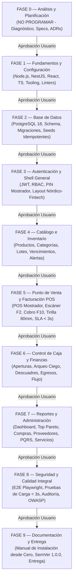

# PLAN MAESTRO DE DESARROLLO POR FASES — TRIANGLE
## METODOLOGÍA, ENTREGABLES, CRITERIOS DE ACEPTACIÓN Y GATES DE APROBACIÓN

**Versión:** 1.0.0  
**Proyecto:** TRIANGLE ERP / POS  
**Organización:** Tienda de Barrio S.A.S. — Bogotá, Colombia  

---

## 1. REGLAS FUNDAMENTALES DEL PLAN

1. **Desarrollo por Fases Independientes:** Cada fase produce entregables tangibles, verificados y documentados.
2. **Prohibición de Avance Automático:** Al finalizar cada fase, el sistema se detiene, presenta el reporte formal (`docs/PHASES/PHASE_XX_REPORT.md`) y **espera la aprobación explícita del usuario**. El silencio no constituye aprobación.
3. **Trazabilidad por Historias de Usuario:** Toda rama, commit y prueba se asocia al identificador de la Historia de Usuario correspondiente (`US-XXX`).
4. **Calidad y Cobertura Obligatoria:** Mínimo 80% de cobertura de código general y 90% en lógica financiera y de inventario.

---

## 2. CRONOGRAMA MAESTRO DE FASES Y DEPENDENCIAS

---

## 3. ESPECIFICACIÓN DETALLADA DE CADA FASE

### FASE 0 — ANÁLISIS Y PLANIFICACIÓN (Fase Actual)
- **Objetivo:** Inspeccionar el repositorio, descomprimir y analizar los recursos visuales (`stitch_triangle_erp_pos_redesign.zip`), evaluar el entorno de ejecución, diseñar la arquitectura monolítica modular, definir el modelo relacional y formular el plan maestro.
- **Regla:** **PROHIBIDO PROGRAMAR CÓDIGO FUNCIONAL O CREAR LA BASE DE DATOS EN ESTA FASE.**
- **Agentes Responsables:** Software Architect & Tech Lead, Database Engineer, UI/UX Designer.
- **Entregables:**
  - `AGENTS.md`, `DESIGN.md`, `PLANNING.md`, `PROJECT.md`
  - `docs/ANALISIS_INICIAL.md`, `docs/REQUIREMENTS.md`, `docs/ARCHITECTURE.md`, `docs/DATABASE.md`
  - Registros de decisiones arquitectónicas en `docs/DECISIONS/` (ADR-001 al ADR-005)
  - Reporte de fase: `docs/PHASES/PHASE_00_REPORT.md`
- **Criterio de Cierre:** Presentación del informe ejecutivo al usuario y recepción de autorización explícita para comenzar la Fase 1.
- **Estado Actual:** `UNDER_REVIEW` (En espera de aprobación del usuario).

---

### FASE 1 — FUNDAMENTOS Y CONFIGURACIÓN
- **Objetivo:** Establecer la infraestructura del código fuente, herramientas de calidad, configuración de TypeScript, linters y scripts de inicio.
- **Historias de Usuario asociadas:** Infraestructura transversal.
- **Actividades:**
  1. Instalar / verificar Node.js LTS en el sistema anfitrión local mediante `winget`.
  2. Inicializar estructura modular del monorepo (`frontend/`, `backend/`, `database/`, `docs/`, `scripts/`).
  3. Configurar Backend con NestJS + TypeScript, ESLint, Prettier, Jest/Vitest.
  4. Configurar Frontend con React 19 + TypeScript + Vite + Tailwind CSS configurado con los tokens de `DESIGN.md`.
  5. Configurar archivos de entorno (`.env.example`) y exclusión (`.gitignore`).
  6. Configurar Semantic Versioning (`VERSION = 0.1.0`, `CHANGELOG.md`).
- **Entregables:** Proyecto base ejecutable, scripts en `package.json`, compilación limpia en frontend y backend.
- **Validaciones:** `npm run build` sin errores, linters pasando sin advertencias, tests de sanidad ejecutados.
- **Punto de Control:** **DETENERSE Y ESPERAR APROBACIÓN DEL USUARIO.**

---

### FASE 2 — BASE DE DATOS Y PERSISTENCIA
- **Objetivo:** Construir físicamente el esquema de base de datos relacional en PostgreSQL 18.6 nativo, aplicar migraciones versionadas y poblar datos semilla.
- **Historias de Usuario asociadas:** Persistencia transversal de todos los dominios.
- **Actividades:**
  1. Configurar conexión a la base de datos PostgreSQL 18 local (`DATABASE_URL`).
  2. Crear y ejecutar el script canónico `database/schema.sql` con todas las tablas, llaves foráneas, índices y restricciones `CHECK`.
  3. Configurar el esquema de Prisma ORM sincronizado con el modelo relacional.
  4. Generar y ejecutar el script idempotente `database/seed.sql` con roles, permisos, categorías, catálogo colombiano de demostración y parámetros base.
  5. Crear script orquestador `database/init.sql` y `database/README.md`.
  6. Ejecutar pruebas automatizadas de persistencia, restricciones y llaves foráneas.
- **Entregables:** Base de datos `triangle_db` creada y verificada con 100% de tablas y seeds.
- **Punto de Control:** **DETENERSE Y ESPERAR APROBACIÓN DEL USUARIO.**

---

### FASE 3 — AUTENTICACIÓN, SEGURIDAD Y SHELL GENERAL
- **Objetivo:** Implementar la autenticación de usuarios, protección de rutas mediante RBAC, PIN rápido para mostrador y el layout base nórdico-fintech.
- **Historias de Usuario:** `US-AUTH-01`, `US-AUTH-02`.
- **Actividades:**
  1. Servicio de autenticación con hashing seguro (Bcrypt) y generación de JWT.
  2. Implementación de PIN numérico de 4 dígitos para desbloqueo ágil de caja en POS.
  3. Guards de autorización por rol (`RolesGuard`) y decorador `@Roles()`.
  4. Frontend: Pantalla de Login, Sidebar de navegación responsivo con avatar y selector de sucursal, Header superior con alertas y estado de turno.
  5. Pruebas unitarias de hashing y pruebas de integración de endpoints `/api/v1/auth/*`.
- **Punto de Control:** **DETENERSE Y ESPERAR APROBACIÓN DEL USUARIO.**

---

### FASE 4 — CATÁLOGO, EXISTENCIAS, LOTES Y ALERTAS
- **Objetivo:** Implementar la gestión completa de productos, existencias, trazabilidad de kárdex, control de lotes con fecha de vencimiento y semáforo de alertas.
- **Historias de Usuario:** `US-CAT-01`, `US-CAT-02`, `US-INV-01`, `US-INV-02`, `US-ALERT-01`, `US-ALERT-02`.
- **Actividades:**
  1. CRUD de categorías y catálogo de productos con SKU, código de barras EAN-13, precios e impuestos.
  2. Módulo de inventario con balance de existencias y movimientos auditables (`stock_movements`).
  3. Control de lotes (`product_batches`) y cálculo automático de días restantes para expiración.
  4. Módulo de alertas visuales con semáforo crítico (Rojo $\le 3$ días, Naranja $\le 7$ días, Amarillo $\le 15$ días) y stock bajo.
  5. Generador de etiquetas/stickers de descuento preventivo (-30%, -50%).
- **Punto de Control:** **DETENERSE Y ESPERAR APROBACIÓN DEL USUARIO.**

---

### FASE 5 — PUNTO DE VENTA (POS) Y FACTURACIÓN (SLA < 3s)
- **Objetivo:** Construir la terminal de mostrador de alto rendimiento para el cajero, con escaneo instantáneo, cobro multiformato y emisión de tirilla térmica de 80 mm.
- **Historias de Usuario:** `US-POS-01`, `US-POS-02`, `US-POS-03`, `US-POS-04`, `US-POS-05`.
- **Actividades:**
  1. Interfaz POS con Omnibox de búsqueda y código de barras con indicador de pulso ("Lector Listo").
  2. Atajos de teclado para operación sin ratón (`F2`, `F10`, `ESC`).
  3. Motor de transacciones ACID en backend con bloqueo `FOR UPDATE` para impedir sobreventas.
  4. Desglose de impuestos por ítem (IVA 0%, 5%, 19%) y cálculo de cambio en pantalla.
  5. Generación de tirilla térmica de 80 mm para Tienda de Barrio S.A.S. (NIT 901.482.109-2).
  6. Medición rigurosa de tiempos de confirmación para garantizar SLA inferior a 3 segundos.
- **Punto de Control:** **DETENERSE Y ESPERAR APROBACIÓN DEL USUARIO.**

---

### FASE 6 — CONTROL DE CAJA, TURNOS Y FINANZAS
- **Objetivo:** Control riguroso del flujo de dinero físico en mostrador, aperturas de sesión, egresos justificados y arqueo ciego al cierre.
- **Historias de Usuario:** `US-CASH-01`, `US-CASH-02`, `US-CASH-03`, `US-FIN-01`.
- **Actividades:**
  1. Apertura de turno con base inicial en efectivo.
  2. Registro de movimientos manuales de caja (retiros, pagos de emergencia, base adicional).
  3. Formulario de arqueo ciego por denominaciones de billetes y monedas colombianas.
  4. Conciliación automática contra el saldo teórico y generación del acta inmutable de cierre.
  5. Control de flujo de caja financiero y registro de pago de servicios públicos de la tienda.
- **Punto de Control:** **DETENERSE Y ESPERAR APROBACIÓN DEL USUARIO.**

---

### FASE 7 — REPORTES, ADMINISTRACIÓN Y OPERACIONES
- **Objetivo:** Consolidar el centro de mando administrativo con métricas analíticas, gestión de proveedores, compras de mercancía, colaboradores y PQRS.
- **Historias de Usuario:** `US-PURCH-01`, `US-PURCH-02`, `US-EMP-01`, `US-EMP-02`, `US-PQRS-01`, `US-REP-01`, `US-REP-02`.
- **Actividades:**
  1. Dashboard analítico con KPIs (ventas hoy, semana, mes, ticket promedio, margen estimado).
  2. Reporte de rotación de productos (Top Pareto) y mermas evitadas.
  3. Directorio de proveedores y formulario de radicación de facturas de compra con asignación de lotes.
  4. Directorio de empleados y cuadrícula de programación semanal de turnos.
  5. Radicación y gestión de solicitudes y reclamos (PQRS).
- **Punto de Control:** **DETENERSE Y ESPERAR APROBACIÓN DEL USUARIO.**

---

### FASE 8 — SEGURIDAD, AUDITORÍA Y CALIDAD INTEGRAL
- **Objetivo:** Asegurar la robustez, blindar la seguridad del sistema, validar la bitácora inmutable y ejecutar la suite completa de pruebas E2E.
- **Historias de Usuario:** `US-AUDIT-01` y matriz de pruebas no funcionales.
- **Actividades:**
  1. Verificación de bitácora de auditoría inmutable (`audit_logs`) en todas las operaciones sensibles.
  2. Pruebas de estrés y concurrencia para validar el cumplimiento del SLA < 3 segundos.
  3. Pruebas End-to-End con Playwright (10 escenarios completos de negocio).
  4. Escaneo de seguridad de dependencias (`npm audit`) y análisis de vulnerabilidades OWASP.
  5. Elaboración del informe de calidad integral `docs/QA_REPORT.md` y `docs/SECURITY.md`.
- **Punto de Control:** **DETENERSE Y ESPERAR APROBACIÓN DEL USUARIO.**

---

### FASE 9 — DOCUMENTACIÓN FINAL, VERSIONAMIENTO Y ENTREGA
- **Objetivo:** Consolidar la documentación técnica y de usuario, validar la instalación desde cero mediante el README y emitir la versión 1.0.0.
- **Actividades:**
  1. Finalizar `README.md` exhaustivo con pasos reproducibles de instalación, inicialización y credenciales de prueba.
  2. Completar documentación de API (`docs/API.md`) y despliegue (`docs/DEPLOYMENT.md`).
  3. Validar prueba de fuego: clonar/limpiar y levantar el proyecto de cero siguiendo únicamente el README.
  4. Actualizar `VERSION` (1.0.0) y `CHANGELOG.md` con Conventional Commits.
  5. Presentar el informe de cierre definitivo del proyecto.
