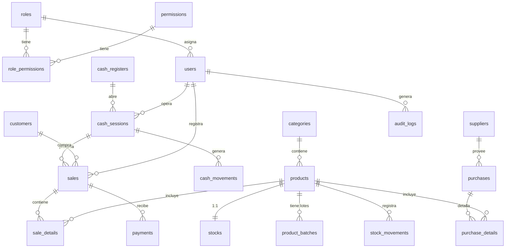

# TRIANGLE — Base de Datos PostgreSQL

## Resumen

| Atributo | Valor |
|---|---|
| **Motor** | PostgreSQL 18.6 |
| **Nombre** | `triangle_db` |
| **Host** | `localhost:5432` |
| **Usuario** | `postgres` |
| **Esquema** | `public` |
| **Tablas** | 25 |
| **Índices** | 23 (12 performance + 11 UNIQUE) |
| **Foreign Keys** | 30 |
| **CHECK Constraints** | 41 |

## Estructura de Archivos

```
database/
├── schema.sql   # DDL: tablas, restricciones, índices (idempotente con IF NOT EXISTS)
├── seed.sql     # DML: datos iniciales (roles, permisos, usuarios, catálogo demo)
├── init.sql     # Orquestador: ejecuta schema.sql + seed.sql en orden
└── README.md    # Este archivo
```

## Requisitos Previos

1. **PostgreSQL 18** instalado y ejecutándose en `localhost:5432`
2. Acceso con usuario `postgres`
3. Extensión `pgcrypto` disponible (incluida por defecto en PostgreSQL)

## Inicialización Rápida

### 1. Crear la base de datos

```bash
# Windows (PowerShell)
& "C:\Program Files\PostgreSQL\18\bin\psql.exe" -U postgres -h localhost -p 5432 -c "CREATE DATABASE triangle_db WITH ENCODING 'UTF8' LC_COLLATE 'Spanish_Colombia.1252' LC_CTYPE 'Spanish_Colombia.1252' TEMPLATE template0;"

# Linux / macOS
psql -U postgres -h localhost -p 5432 -c "CREATE DATABASE triangle_db WITH ENCODING 'UTF8' LC_COLLATE 'es_CO.UTF-8' LC_CTYPE 'es_CO.UTF-8' TEMPLATE template0;"
```

### 2. Ejecutar la inicialización completa

```bash
# Windows (PowerShell)
$env:PGPASSWORD = "<contraseña>"
& "C:\Program Files\PostgreSQL\18\bin\psql.exe" -U postgres -h localhost -p 5432 -d triangle_db -f database/init.sql

# Linux / macOS
PGPASSWORD=<contraseña> psql -U postgres -h localhost -p 5432 -d triangle_db -f database/init.sql
```

> [!TIP]
> `init.sql` es idempotente — puede re-ejecutarse sin errores.

### 3. Verificar la instalación

```sql
-- Contar tablas (debe retornar 25)
SELECT count(*) FROM information_schema.tables WHERE table_schema = 'public';

-- Verificar datos seed
SELECT 'roles' AS t, count(*) FROM roles
UNION ALL SELECT 'users', count(*) FROM users
UNION ALL SELECT 'products', count(*) FROM products
UNION ALL SELECT 'categories', count(*) FROM categories;
```

## Modelo de Datos

### Dominios

| # | Dominio | Tablas | Descripción |
|---|---------|--------|-------------|
| 1 | **Identidad & RBAC** | `roles`, `permissions`, `role_permissions`, `users` | Autenticación, autorización, permisos por módulo |
| 2 | **Catálogo & Inventario** | `categories`, `products`, `stocks`, `product_batches`, `stock_movements` | Productos, lotes, fechas de vencimiento, trazabilidad |
| 3 | **Caja & Turnos** | `cash_registers`, `cash_sessions`, `cash_movements` | Apertura/cierre ciego, ingresos, egresos, retiros |
| 4 | **Ventas & Pagos** | `customers`, `sales`, `sale_details`, `payments` | POS, facturación, fiado, múltiples métodos de pago |
| 5 | **Compras & Proveedores** | `suppliers`, `purchases`, `purchase_details` | Órdenes de compra, recepción, costos |
| 6 | **Administración** | `employees`, `customer_requests`, `utility_accounts`, `utility_payments` | RRHH, PQRS, servicios públicos |
| 7 | **Auditoría & Config** | `audit_logs`, `system_settings` | Bitácora inmutable, parámetros del sistema |

### Diagrama Entidad-Relación (Simplificado)



## Datos Iniciales (Seed)

| Entidad | Cantidad | Detalle |
|---------|----------|---------|
| **Roles** | 3 | ADMINISTRADOR, CAJERO, ALMACENISTA |
| **Permisos** | 12 | Módulos: auth, dashboard, inventory, pos, cash, reports, purchases, suppliers, employees, pqrs, settings, admin |
| **Role-Permisos** | 20 | Admin: 12, Cajero: 4, Almacenista: 4 |
| **Usuarios demo** | 3 | admin@triangle.com, cajero@triangle.com, almacen@triangle.com |
| **Categorías** | 5 | 🥛 Lácteos, 🌾 Granos, 🥚 Huevos, 🍪 Snacks, 🧹 Aseo |
| **Productos** | 7 | Leche Alquería, Arroz Diana, Huevos Santa Reyes, etc. |
| **Stocks** | 7 | Inventario inicial para cada producto |
| **Lotes** | 4 | Incluyendo 1 lote próximo a vencer (3 días) |
| **Proveedores** | 3 | Alquería, Postobón, Diana |
| **Clientes** | 3 | Consumidor Final + 2 clientes fiado |
| **Caja registradora** | 1 | Caja Mostrador 01 |
| **Servicios públicos** | 3 | Codensa, Acueducto, Claro |
| **Configuración** | 9 | NIT, nombre, dirección, IVA, moneda, etc. |

> [!IMPORTANT]
> Las contraseñas de los usuarios demo están hasheadas con bcrypt. El hash incluido corresponde a la contraseña `Admin123*` (se debe verificar al implementar el módulo de autenticación).

## Convenciones

### Tipos de Datos Monetarios
- **Siempre** `NUMERIC(14,2)` — nunca `FLOAT`, `REAL` o `DOUBLE PRECISION`
- Soporta valores hasta \$99,999,999,999.99

### Eliminación Suave
- Todas las entidades maestras tienen `is_active BOOLEAN DEFAULT TRUE`
- Los registros transaccionales **nunca** se eliminan físicamente
- Se usa `status` con valores tipo ENUM via CHECK para estados de flujo

### Timestamps
- Todos los timestamps son `TIMESTAMPTZ` (con zona horaria)
- `created_at` siempre tiene `DEFAULT CURRENT_TIMESTAMP`
- `updated_at` se gestiona desde la capa de aplicación (NestJS/Prisma)

### Claves Primarias
- Tablas principales: `UUID` con `gen_random_uuid()` (pgcrypto)
- Tablas de referencia: `VARCHAR` con ID semántico (ej: `'ADMINISTRADOR'`, `'inventory.read'`)

### Tasas de IVA
- Solo se permiten: `0.00`, `5.00`, `19.00` (Ley colombiana)
- Restricción CHECK a nivel de base de datos

## Prisma ORM

La base de datos se sincroniza con el backend NestJS via Prisma ORM:

```bash
# Introspeccionar esquema existente
cd backend
npx prisma db pull

# Generar cliente
npx prisma generate

# Ver el esquema
cat prisma/schema.prisma
```

El `DATABASE_URL` se configura en `backend/.env`:
```
DATABASE_URL="postgresql://postgres:<contraseña>@localhost:5432/triangle_db?schema=public"
```

## Troubleshooting

### Error: "database triangle_db does not exist"
Crear la base de datos manualmente (ver sección Inicialización).

### Error: "permission denied for schema public"
```sql
GRANT ALL ON SCHEMA public TO postgres;
```

### Error: "extension pgcrypto does not exist"
```sql
CREATE EXTENSION IF NOT EXISTS "pgcrypto";
```

### Reiniciar la base de datos desde cero
```sql
DROP DATABASE IF EXISTS triangle_db;
CREATE DATABASE triangle_db ...;
-- Luego ejecutar init.sql
```
