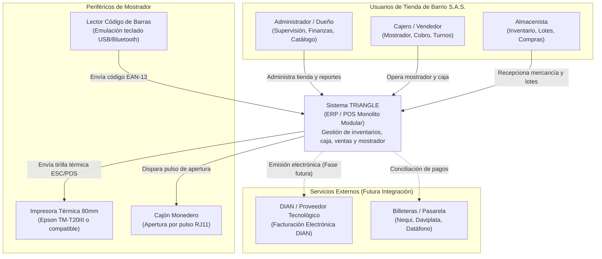
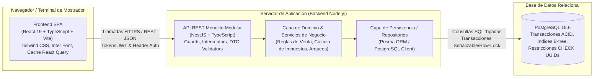
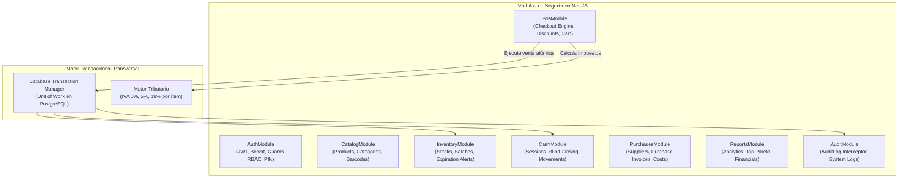
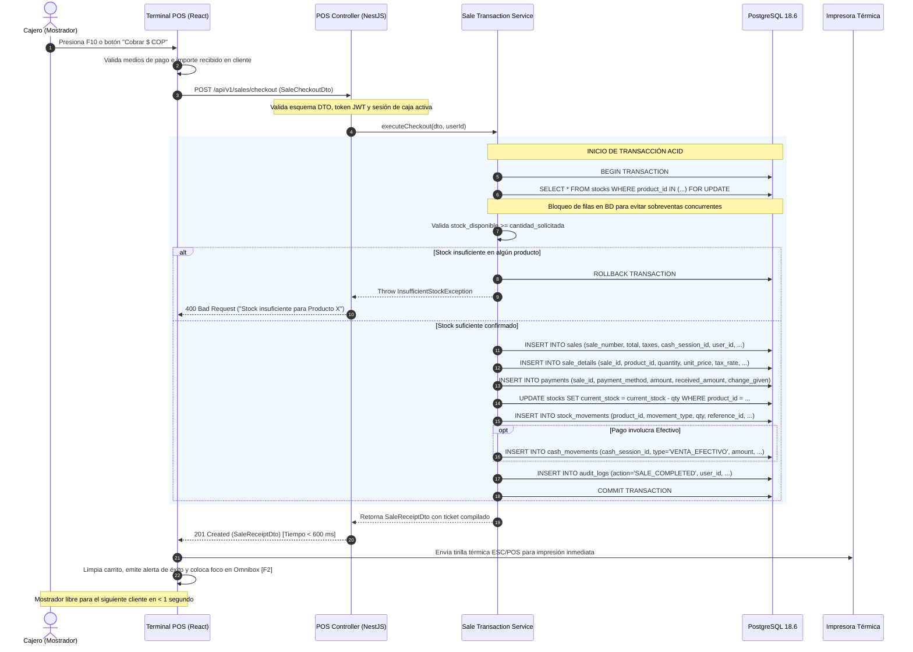

# ARQUITECTURA TECNICA DEL SISTEMA — TRIANGLE
## MONOLITO MODULAR, CLEAN ARCHITECTURE Y ALTA CONCURRENCIA

**Versión:** 1.0.0-draft  
**Fase:** FASE 0 — ANÁLISIS Y PLANIFICACIÓN  
**Estado:** `UNDER_REVIEW`  
**Autor:** Software Architect & Technical Lead  

---

## 1. VISION ARQUITECTÓNICA Y PRINCIPIOS DE DISEÑO

El sistema **TRIANGLE** está concebido como un **Monolito Modular** de alto rendimiento, organizado por dominios de negocio claramente delimitados y estructurado bajo los principios de **Clean Architecture** y **Domain-Driven Design (DDD)** pragmático.

### 1.1. Justificación de la Arquitectura Monolito Modular
Para una tienda de barrio o cadena de minimercados, un monolito modular ofrece ventajas determinantes frente a una arquitectura de microservicios:
- **Transacciones ACID atómicas nativas:** Permite que la confirmación de una venta, el descuento de stock, el movimiento de caja y el registro de auditoría ocurran dentro de una **única transacción de base de datos** sin la complejidad ni la eventual inconsistencia de patrones distribuidos como SAGA o two-phase commit.
- **Despliegue y operación simplificados:** Una sola unidad de ejecución que puede correr en la máquina física del mostrador o en un servidor local/en la nube, reduciendo costos de infraestructura y latencia de red entre servicios.
- **Límites modulares estrictos:** Aunque el código corre en un único proceso, cada módulo posee su propio espacio de nombres, entidades, servicios, DTOs y controladores, permitiendo extraer módulos a microservicios independientes en el futuro si el volumen lo justificara.

### 1.2. Principios de Ingeniería Aplicados
- **SOLID:** Especial énfasis en Responsabilidad Única (SRP) e Inversión de Dependencias (DIP) mediante interfaces de repositorio y servicios desacoplados.
- **Separation of Concerns (SoC):** La lógica de negocio y las fórmulas financieras residen exclusivamente en el núcleo de dominio y la capa de aplicación del servidor; el frontend es un cliente rico de presentación e interacción.
- **Defensive Programming & Fail-Fast:** Validación exhaustiva de entradas (DTOs con class-validator) en el límite del sistema antes de alcanzar la capa de dominio.
- **Single Source of Truth:** La base de datos relacional PostgreSQL 18 es la única fuente de verdad transaccional.

---

## 2. DIAGRAMAS C4 DE ARQUITECTURA

### 2.1. C4 Nivel 1: Diagrama de Contexto del Sistema



---

### 2.2. C4 Nivel 2: Diagrama de Contenedores



---

### 2.3. C4 Nivel 3: Diagrama de Componentes del Backend



---

## 3. FLUJO TRANSACCIONAL DE CHECKOUT EN PUNTO DE VENTA (SLA < 3s)

Para cumplir estrictamente el requisito no funcional de facturación y cobro en **máximo 3 segundos**, el flujo de confirmación de venta está optimizado al milisegundo mediante una única transacción atómica con bloqueo pesimista de existencias:



---

## 4. ESTRUCTURA EN CAPAS (CLEAN ARCHITECTURE)

Cada módulo de backend se divide estrictamente en cuatro capas concéntricas:

1. **Capa de Dominio (Domain Layer):**
   - Entidades puras y objetos de valor (Value Objects).
   - Reglas y restricciones intrínsecas del negocio (ej. validación de que un precio de venta no puede ser menor a cero, cálculo de margen de ganancia).
   - Sin dependencias de frameworks ni de bases de datos.

2. **Capa de Aplicación (Application Layer):**
   - Casos de uso (Use Cases) y servicios de aplicación.
   - Definición de interfaces de puertos (Interfaces de Repositorios, Servicios de Notificación, Proveedores de Facturación).
   - DTOs de entrada y salida con validaciones tipadas.

3. **Capa de Infraestructura (Infrastructure Layer):**
   - Implementaciones concretas de repositorios con Prisma ORM / PostgreSQL.
   - Adaptadores de periféricos (driver de impresión térmica ESC/POS, lectores).
   - Configuración de base de datos, migraciones y seeds.

4. **Capa de Presentación (Presentation Layer):**
   - Controladores REST (`@Controller`) con decoradores NestJS.
   - Filtros globales de excepción, transformadores e interceptores de auditoría.
   - Documentación automática Swagger / OpenAPI.

---

## 5. CONTROL DE ACCESO BASADO EN ROLES (RBAC)

La matriz de seguridad se implementa en el backend mediante un Guard transversal `@UseGuards(JwtAuthGuard, RolesGuard)`:

| Módulo / Operación | Administrador | Cajero | Almacenista |
|---|:---:|:---:|:---:|
| **POS: Armar Carrito y Vender** | ✅ Permitido | ✅ Permitido | ❌ Denegado |
| **POS: Anular Venta Confirmada** | ✅ Permitido | ⚠️ Requiere clave Admin | ❌ Denegado |
| **Caja: Apertura y Cierre de Turno** | ✅ Permitido | ✅ Solo su propia sesión | ❌ Denegado |
| **Caja: Consulta de Arqueo Teórico en Curso** | ✅ Permitido | ❌ Arqueo Ciego (Oculto) | ❌ Denegado |
| **Inventario: Consulta de Existencias** | ✅ Permitido | ✅ Permitido | ✅ Permitido |
| **Inventario: Crear / Editar Productos** | ✅ Permitido | ❌ Denegado | ✅ Permitido |
| **Inventario: Ajuste de Mermas / Lotes** | ✅ Permitido | ❌ Denegado | ✅ Permitido |
| **Compras: Registrar Factura de Proveedor** | ✅ Permitido | ❌ Denegado | ✅ Permitido |
| **Personal: Empleados y Turnos** | ✅ Permitido | ❌ Denegado | ❌ Denegado |
| **Finanzas: Flujo de Caja y Servicios** | ✅ Permitido | ❌ Denegado | ❌ Denegado |
| **Reportes: Métricas y Márgenes de Ganancia**| ✅ Permitido | ❌ Denegado | ❌ Denegado |
| **Auditoría: Consulta de Bitácora del Sistema** | ✅ Permitido | ❌ Denegado | ❌ Denegado |

---

## 6. ESTRATEGIA DE MANEJO DE ERRORES Y CONTRATO DE API

Todas las respuestas de error siguen una envoltura JSON unificada (`GlobalExceptionFilter`), evitando fugas de información interna y facilitando la depuración:

```json
{
  "success": false,
  "statusCode": 400,
  "errorCode": "INSUFFICIENT_STOCK",
  "message": "Existencias insuficientes para 'Arroz Diana 1kg'. Disponibles: 2, Solicitadas: 5.",
  "timestamp": "2026-11-21T21:40:00.000Z",
  "path": "/api/v1/sales/checkout",
  "details": {
    "productId": "prod_diana_01",
    "available": 2,
    "requested": 5
  }
}
```
