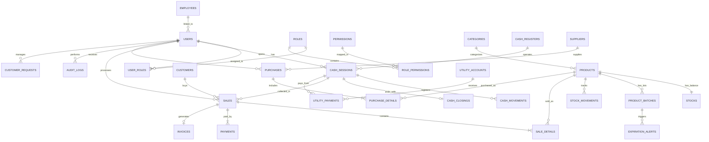

# ESPECIFICACION DEL MODELO DE BASE DE DATOS — TRIANGLE
## ESQUEMA RELACIONAL EN POSTGRESQL 18 PARA TIENDA DE BARRIO S.A.S.

**Versión:** 1.0.0-draft  
**Fase:** FASE 0 — ANÁLISIS Y PLANIFICACIÓN  
**Estado:** `UNDER_REVIEW`  
**Autor:** Database Engineer & Software Architect  

---

## 1. PRINCIPIOS Y ESTÁNDARES DEL MODELO DE DATOS

1. **Gestor de Base de Datos:** PostgreSQL 18.6 nativo (instalado y verificado en `C:\Program Files\PostgreSQL\18`).
2. **Convenciones de Nomenclatura:**
   - Nombres de tablas en minúsculas y plural: `users`, `products`, `sales`, `cash_sessions`.
   - Nombres de columnas en `snake_case`: `product_id`, `created_at`, `sale_number`.
   - Claves primarias: `id` de tipo `UUID` (generado por `gen_random_uuid()`) o `BIGSERIAL` para secuenciales de alto rendimiento.
   - Claves foráneas: `{entidad_singular}_id`, por ejemplo `category_id`, `user_id`.
   - Marcas de tiempo: `created_at` y `updated_at` de tipo `TIMESTAMPTZ` con valor por defecto `CURRENT_TIMESTAMP`.
3. **Manejo Monetario y de Cantidades:**
   - **Prohibido el uso de `FLOAT` o `REAL`:** Todo valor monetario (costos, precios, subtotales, IVA, pagos, bases de caja) se almacena en `NUMERIC(14,2)`.
   - Cantidades de inventario fraccionables (ej. frutas o granos pesados por kilo): `NUMERIC(12,3)`.
4. **Integridad Referencial y Restricciones:**
   - Restricciones `CHECK` para evitar stock negativo (`current_stock >= 0`), precios negativos o estados no válidos.
   - Restricciones `UNIQUE` en códigos de barras (`barcode`), números de comprobante y números de identificación (cédula/NIT).
   - Políticas de eliminación: En tablas transaccionales (ventas, pagos, compras, movimientos) se utiliza `ON DELETE RESTRICT` para garantizar inmutabilidad histórica.
   - Baja lógica en entidades maestras (`is_active BOOLEAN DEFAULT TRUE`, `deleted_at TIMESTAMPTZ NULL`).

---

## 2. DIAGRAMA ENTIDAD-RELACIÓN (MERMAID ERD)

---

## 3. DICCIONARIO DE DATOS Y ESPECIFICACIÓN DE TABLAS

### 3.1. Dominio de Identidad y Seguridad (RBAC)

#### Tabla: `roles`
- `id` (VARCHAR(30), PK): Clave primaria (`ADMINISTRADOR`, `CAJERO`, `ALMACENISTA`).
- `name` (VARCHAR(50), NOT NULL): Nombre legible.
- `description` (TEXT): Descripción de responsabilidades.
- `created_at` (TIMESTAMPTZ, DEFAULT NOW()).

#### Tabla: `permissions`
- `id` (VARCHAR(60), PK): Identificador jerárquico (ej. `pos:checkout`, `inventory:adjust`, `cash:blind_close`, `reports:view`).
- `module` (VARCHAR(40), NOT NULL): Módulo funcional.
- `description` (TEXT): Descripción del permiso.

#### Tabla: `users`
- `id` (UUID, PK, DEFAULT gen_random_uuid()): Identificador único.
- `email` (VARCHAR(150), UNIQUE, NOT NULL): Correo electrónico para acceso administrativo.
- `username` (VARCHAR(50), UNIQUE, NOT NULL): Nombre de usuario para mostrador.
- `password_hash` (VARCHAR(255), NOT NULL): Hash Bcrypt/Argon2 de la contraseña principal.
- `pos_pin_hash` (VARCHAR(255), NULL): Hash del PIN numérico de 4 dígitos para desbloqueo rápido de mostrador.
- `full_name` (VARCHAR(150), NOT NULL): Nombre y apellido del colaborador.
- `role_id` (VARCHAR(30), NOT NULL, FK -> `roles.id`): Rol asignado.
- `is_active` (BOOLEAN, DEFAULT TRUE): Estado de la cuenta.
- `created_at` (TIMESTAMPTZ, DEFAULT NOW()).
- `updated_at` (TIMESTAMPTZ, DEFAULT NOW()).

---

### 3.2. Dominio de Catálogo e Inventario

#### Tabla: `categories`
- `id` (UUID, PK, DEFAULT gen_random_uuid())
- `name` (VARCHAR(80), UNIQUE, NOT NULL): Nombre de categoría (ej: Lácteos, Abarrotes, Bebidas & Snacks).
- `icon` (VARCHAR(40), NULL): Nombre de ícono de Material Symbols o emoji representativo.
- `is_active` (BOOLEAN, DEFAULT TRUE).

#### Tabla: `products`
- `id` (UUID, PK, DEFAULT gen_random_uuid())
- `category_id` (UUID, NOT NULL, FK -> `categories.id`)
- `sku` (VARCHAR(50), UNIQUE, NOT NULL): Código interno de referencia.
- `barcode` (VARCHAR(50), UNIQUE, NULL): Código de barras EAN-13 / UPC escaneable.
- `name` (VARCHAR(150), NOT NULL): Nombre comercial (ej: "Leche Alquería Entera 1L").
- `description` (TEXT, NULL)
- `unit_of_measure` (VARCHAR(20), NOT NULL, DEFAULT 'UNIDAD'): UNIDAD, KG, LB, LT, PAQUETE.
- `cost_price` (NUMERIC(14,2), NOT NULL, CHECK (cost_price >= 0)): Costo de compra ponderado.
- `sale_price` (NUMERIC(14,2), NOT NULL, CHECK (sale_price >= 0)): Precio de venta al público.
- `tax_rate` (NUMERIC(5,2), NOT NULL, DEFAULT 0.00, CHECK (tax_rate IN (0.00, 5.00, 19.00))): Porcentaje de IVA.
- `min_stock` (NUMERIC(12,3), NOT NULL, DEFAULT 5.000, CHECK (min_stock >= 0)): Umbral de alerta de stock bajo.
- `location_shelf` (VARCHAR(50), NULL): Ubicación física (ej: "Nevera 2 - Pasillo A").
- `image_url` (TEXT, NULL): URL o recurso visual del producto.
- `is_active` (BOOLEAN, DEFAULT TRUE).
- `created_at` (TIMESTAMPTZ, DEFAULT NOW()).
- `updated_at` (TIMESTAMPTZ, DEFAULT NOW()).

#### Tabla: `stocks`
- `id` (UUID, PK, DEFAULT gen_random_uuid())
- `product_id` (UUID, UNIQUE, NOT NULL, FK -> `products.id` ON DELETE RESTRICT)
- `current_stock` (NUMERIC(12,3), NOT NULL, DEFAULT 0.000, CHECK (current_stock >= 0)): Existencias reales físicas.
- `last_updated_at` (TIMESTAMPTZ, DEFAULT NOW()).

#### Tabla: `product_batches` (Lotes y Vencimientos)
- `id` (UUID, PK, DEFAULT gen_random_uuid())
- `product_id` (UUID, NOT NULL, FK -> `products.id` ON DELETE RESTRICT)
- `batch_number` (VARCHAR(50), NOT NULL): Número de lote asignado por el fabricante o proveedor.
- `expiration_date` (DATE, NOT NULL): Fecha de caducidad.
- `initial_quantity` (NUMERIC(12,3), NOT NULL, CHECK (initial_quantity > 0))
- `remaining_quantity` (NUMERIC(12,3), NOT NULL, CHECK (remaining_quantity >= 0))
- `is_active` (BOOLEAN, DEFAULT TRUE)
- `created_at` (TIMESTAMPTZ, DEFAULT NOW()).

#### Tabla: `stock_movements` (Kárdex y Trazabilidad)
- `id` (UUID, PK, DEFAULT gen_random_uuid())
- `product_id` (UUID, NOT NULL, FK -> `products.id`)
- `batch_id` (UUID, NULL, FK -> `product_batches.id`)
- `movement_type` (VARCHAR(35), NOT NULL): `ENTRADA_COMPRA`, `SALIDA_VENTA`, `AJUSTE_MERMA_VENCIMIENTO`, `AJUSTE_CONTEO`, `DEVOLUCION_VENTA`, `DEVOLUCION_COMPRA`.
- `quantity` (NUMERIC(12,3), NOT NULL, CHECK (quantity != 0)): Cantidad desplazada (positiva para entradas, negativa para salidas).
- `previous_stock` (NUMERIC(12,3), NOT NULL)
- `new_stock` (NUMERIC(12,3), NOT NULL)
- `reference_id` (VARCHAR(100), NULL): ID de la venta, compra o acta de ajuste.
- `notes` (TEXT, NULL)
- `user_id` (UUID, NOT NULL, FK -> `users.id`)
- `created_at` (TIMESTAMPTZ, DEFAULT NOW()).

---

### 3.3. Dominio de Caja y Turnos

#### Tabla: `cash_registers`
- `id` (UUID, PK, DEFAULT gen_random_uuid())
- `name` (VARCHAR(50), NOT NULL): "Caja Principal 01 - Mostrador".
- `branch_name` (VARCHAR(80), NOT NULL, DEFAULT 'Sede Chapinero').
- `is_active` (BOOLEAN, DEFAULT TRUE).

#### Tabla: `cash_sessions` (Turnos de Mostrador)
- `id` (UUID, PK, DEFAULT gen_random_uuid())
- `cash_register_id` (UUID, NOT NULL, FK -> `cash_registers.id`)
- `user_id` (UUID, NOT NULL, FK -> `users.id`)
- `opening_time` (TIMESTAMPTZ, NOT NULL, DEFAULT NOW())
- `closing_time` (TIMESTAMPTZ, NULL)
- `initial_cash_amount` (NUMERIC(14,2), NOT NULL, CHECK (initial_cash_amount >= 0)): Base de caja inicial.
- `final_cash_expected` (NUMERIC(14,2), NULL): Saldo teórico calculado por el sistema al cierre.
- `final_cash_counted` (NUMERIC(14,2), NULL): Monto físico contado por el cajero (Arqueo ciego).
- `discrepancy_amount` (NUMERIC(14,2), NULL): Diferencia final (sobrante positivo / faltante negativo).
- `status` (VARCHAR(20), NOT NULL, DEFAULT 'OPEN', CHECK (status IN ('OPEN', 'CLOSED', 'AUDITED'))).

#### Tabla: `cash_movements`
- `id` (UUID, PK, DEFAULT gen_random_uuid())
- `cash_session_id` (UUID, NOT NULL, FK -> `cash_sessions.id`)
- `movement_type` (VARCHAR(30), NOT NULL, CHECK (movement_type IN ('VENTA_EFECTIVO', 'INGRESO_MANUAL', 'EGRESO_MANUAL', 'PAGO_SERVICIO', 'RETIRO_SEGURIDAD')))
- `amount` (NUMERIC(14,2), NOT NULL, CHECK (amount > 0))
- `reason` (TEXT, NOT NULL): Justificación obligatoria del movimiento.
- `user_id` (UUID, NOT NULL, FK -> `users.id`)
- `created_at` (TIMESTAMPTZ, DEFAULT NOW()).

---

### 3.4. Dominio de Ventas y Facturación POS

#### Tabla: `customers`
- `id` (UUID, PK, DEFAULT gen_random_uuid())
- `document_number` (VARCHAR(30), UNIQUE, NULL): Cédula o NIT (opcional para consumidor final).
- `full_name` (VARCHAR(150), NOT NULL, DEFAULT 'Cliente Ocasional')
- `phone` (VARCHAR(30), NULL)
- `address` (VARCHAR(150), NULL)
- `credit_limit` (NUMERIC(14,2), NOT NULL, DEFAULT 0.00, CHECK (credit_limit >= 0)): Cupo máximo autorizado para fiados.
- `current_debt` (NUMERIC(14,2), NOT NULL, DEFAULT 0.00, CHECK (current_debt >= 0)): Deuda pendiente actual.
- `is_active` (BOOLEAN, DEFAULT TRUE).

#### Tabla: `sales`
- `id` (UUID, PK, DEFAULT gen_random_uuid())
- `sale_number` (VARCHAR(40), UNIQUE, NOT NULL): Consecutivo formateado (ej: `TKT-0004921`).
- `cash_session_id` (UUID, NOT NULL, FK -> `cash_sessions.id`)
- `user_id` (UUID, NOT NULL, FK -> `users.id`)
- `customer_id` (UUID, NULL, FK -> `customers.id`)
- `subtotal` (NUMERIC(14,2), NOT NULL, CHECK (subtotal >= 0))
- `discount_total` (NUMERIC(14,2), NOT NULL, DEFAULT 0.00, CHECK (discount_total >= 0))
- `tax_total` (NUMERIC(14,2), NOT NULL, DEFAULT 0.00, CHECK (tax_total >= 0))
- `total` (NUMERIC(14,2), NOT NULL, CHECK (total >= 0))
- `status` (VARCHAR(20), NOT NULL, DEFAULT 'COMPLETED', CHECK (status IN ('COMPLETED', 'VOIDED', 'REFUNDED')))
- `voided_reason` (TEXT, NULL)
- `voided_by_user_id` (UUID, NULL, FK -> `users.id`)
- `created_at` (TIMESTAMPTZ, DEFAULT NOW()).

#### Tabla: `sale_details`
- `id` (UUID, PK, DEFAULT gen_random_uuid())
- `sale_id` (UUID, NOT NULL, FK -> `sales.id` ON DELETE RESTRICT)
- `product_id` (UUID, NOT NULL, FK -> `products.id` ON DELETE RESTRICT)
- `batch_id` (UUID, NULL, FK -> `product_batches.id`)
- `quantity` (NUMERIC(12,3), NOT NULL, CHECK (quantity > 0))
- `unit_cost` (NUMERIC(14,2), NOT NULL, CHECK (unit_cost >= 0)): Costo histórico al momento de la venta.
- `unit_price` (NUMERIC(14,2), NOT NULL, CHECK (unit_price >= 0))
- `discount_rate` (NUMERIC(5,2), NOT NULL, DEFAULT 0.00, CHECK (discount_rate >= 0))
- `tax_rate` (NUMERIC(5,2), NOT NULL, DEFAULT 0.00)
- `tax_amount` (NUMERIC(14,2), NOT NULL, DEFAULT 0.00)
- `subtotal` (NUMERIC(14,2), NOT NULL, CHECK (subtotal >= 0))
- `total` (NUMERIC(14,2), NOT NULL, CHECK (total >= 0)).

#### Tabla: `payments`
- `id` (UUID, PK, DEFAULT gen_random_uuid())
- `sale_id` (UUID, NOT NULL, FK -> `sales.id` ON DELETE RESTRICT)
- `payment_method` (VARCHAR(30), NOT NULL, CHECK (payment_method IN ('EFECTIVO', 'TARJETA_DEBITO', 'TARJETA_CREDITO', 'NEQUI', 'DAVIPLATA', 'TRANSFIYA', 'CREDITO_FIADO')))
- `amount` (NUMERIC(14,2), NOT NULL, CHECK (amount > 0))
- `amount_tendered` (NUMERIC(14,2), NOT NULL, DEFAULT 0.00, CHECK (amount_tendered >= 0)): Monto entregado por el cliente.
- `change_returned` (NUMERIC(14,2), NOT NULL, DEFAULT 0.00, CHECK (change_returned >= 0)): Cambio devuelto.
- `reference_code` (VARCHAR(100), NULL): Código de aprobación de voucher o comprobante digital Nequi.
- `created_at` (TIMESTAMPTZ, DEFAULT NOW()).

---

### 3.5. Dominio de Compras y Proveedores

#### Tabla: `suppliers`
- `id` (UUID, PK, DEFAULT gen_random_uuid())
- `nit_or_id` (VARCHAR(30), UNIQUE, NOT NULL): NIT o identificación tributaria del distribuidor.
- `company_name` (VARCHAR(150), NOT NULL): Ej: "Bavaria S.A.", "Alpina Productos Alimenticios", "Postobón S.A.".
- `contact_name` (VARCHAR(100), NULL): Nombre del preventista o asesor comercial.
- `phone` (VARCHAR(30), NOT NULL)
- `email` (VARCHAR(120), NULL)
- `visit_days` (VARCHAR(50), NULL): "Martes y Viernes".
- `payment_terms_days` (INT, NOT NULL, DEFAULT 0): Plazo de crédito (0 = Contado).
- `is_active` (BOOLEAN, DEFAULT TRUE).

#### Tabla: `purchases`
- `id` (UUID, PK, DEFAULT gen_random_uuid())
- `supplier_id` (UUID, NOT NULL, FK -> `suppliers.id`)
- `supplier_invoice_number` (VARCHAR(50), NOT NULL): Número de factura del distribuidor.
- `user_id` (UUID, NOT NULL, FK -> `users.id`)
- `total_cost` (NUMERIC(14,2), NOT NULL, CHECK (total_cost >= 0))
- `status` (VARCHAR(20), NOT NULL, DEFAULT 'RECEIVED', CHECK (status IN ('PENDING', 'RECEIVED', 'CANCELLED')))
- `received_at` (TIMESTAMPTZ, NOT NULL, DEFAULT NOW()).

#### Tabla: `purchase_details`
- `id` (UUID, PK, DEFAULT gen_random_uuid())
- `purchase_id` (UUID, NOT NULL, FK -> `purchases.id` ON DELETE RESTRICT)
- `product_id` (UUID, NOT NULL, FK -> `products.id`)
- `batch_number` (VARCHAR(50), NULL)
- `expiration_date` (DATE, NULL)
- `quantity` (NUMERIC(12,3), NOT NULL, CHECK (quantity > 0))
- `unit_cost` (NUMERIC(14,2), NOT NULL, CHECK (unit_cost >= 0))
- `total_cost` (NUMERIC(14,2), NOT NULL, CHECK (total_cost >= 0)).

---

### 3.6. Dominio de Administración, PQRS y Servicios

#### Tabla: `employees`
- `id` (UUID, PK, DEFAULT gen_random_uuid())
- `document_number` (VARCHAR(30), UNIQUE, NOT NULL)
- `full_name` (VARCHAR(150), NOT NULL)
- `position` (VARCHAR(60), NOT NULL): Cajero, Almacenista, Administrador.
- `phone` (VARCHAR(30), NOT NULL)
- `hire_date` (DATE, NOT NULL)
- `emergency_contact` (VARCHAR(150), NULL)
- `is_active` (BOOLEAN, DEFAULT TRUE).

#### Tabla: `customer_requests` (PQRS)
- `id` (UUID, PK, DEFAULT gen_random_uuid())
- `ticket_code` (VARCHAR(30), UNIQUE, NOT NULL): Código de seguimiento (ej: `PQR-2026-0012`).
- `customer_name` (VARCHAR(150), NOT NULL)
- `customer_contact` (VARCHAR(100), NOT NULL)
- `request_type` (VARCHAR(30), NOT NULL, CHECK (request_type IN ('PETICION', 'QUEJA', 'RECLAMO', 'SUGERENCIA')))
- `description` (TEXT, NOT NULL)
- `status` (VARCHAR(20), NOT NULL, DEFAULT 'RECIBIDA', CHECK (status IN ('RECIBIDA', 'EN_GESTION', 'RESUELTA', 'CERRADA')))
- `resolution_notes` (TEXT, NULL)
- `created_by_user_id` (UUID, NOT NULL, FK -> `users.id`)
- `created_at` (TIMESTAMPTZ, DEFAULT NOW()).

#### Tabla: `utility_accounts` (Servicios Públicos)
- `id` (UUID, PK, DEFAULT gen_random_uuid())
- `service_type` (VARCHAR(40), NOT NULL): ENERGIA_ELECTRICA, ACUEDUCTO_ALCANTARILLADO, GAS_NATURAL, INTERNET_TELEFONIA.
- `company_name` (VARCHAR(80), NOT NULL): "Enel Codensa", "Acueducto de Bogotá", "Vanti Gas Natural", "Claro".
- `account_number` (VARCHAR(50), NOT NULL): Número de cuenta / NIC / Código de pago.
- `is_active` (BOOLEAN, DEFAULT TRUE).

#### Tabla: `utility_payments`
- `id` (UUID, PK, DEFAULT gen_random_uuid())
- `utility_account_id` (UUID, NOT NULL, FK -> `utility_accounts.id`)
- `cash_session_id` (UUID, NULL, FK -> `cash_sessions.id`)
- `bill_period` (VARCHAR(30), NOT NULL): "Noviembre 2026"
- `amount` (NUMERIC(14,2), NOT NULL, CHECK (amount > 0))
- `due_date` (DATE, NOT NULL)
- `payment_date` (TIMESTAMPTZ, NOT NULL, DEFAULT NOW())
- `receipt_voucher_number` (VARCHAR(80), NULL)
- `paid_by_user_id` (UUID, NOT NULL, FK -> `users.id`).

---

### 3.7. Dominio de Auditoría y Configuración

#### Tabla: `audit_logs`
- `id` (UUID, PK, DEFAULT gen_random_uuid())
- `user_id` (UUID, NULL, FK -> `users.id`)
- `action` (VARCHAR(60), NOT NULL): `AUTH_LOGIN`, `SALE_COMPLETED`, `SALE_VOIDED`, `CASH_OPENED`, `CASH_CLOSED`, `STOCK_ADJUSTED`, `PRICE_CHANGED`.
- `entity_name` (VARCHAR(50), NOT NULL): `sales`, `stocks`, `products`, `cash_sessions`.
- `entity_id` (VARCHAR(100), NULL)
- `old_values` (JSONB, NULL): Snapshot antes del cambio.
- `new_values` (JSONB, NULL): Snapshot después del cambio.
- `ip_address` (VARCHAR(45), NULL)
- `user_agent` (TEXT, NULL)
- `created_at` (TIMESTAMPTZ, DEFAULT NOW()).

#### Tabla: `system_settings`
- `key` (VARCHAR(60), PK): Clave del parámetro (ej. `business.nit`, `pos.thermal_printer_name`, `alert.expiration_days_warning`).
- `value` (TEXT, NOT NULL): Valor del parámetro serializado o texto plano.
- `description` (TEXT, NULL)
- `updated_at` (TIMESTAMPTZ, DEFAULT NOW()).

---

## 4. ESTRATEGIA DE ÍNDICES PARA ALTO RENDIMIENTO (< 3s)

Para asegurar lecturas instantáneas y búsquedas ultra rápidas en el mostrador:
1. `CREATE INDEX idx_products_barcode ON products (barcode) WHERE barcode IS NOT NULL;`
2. `CREATE INDEX idx_products_sku ON products (sku);`
3. `CREATE INDEX idx_products_category ON products (category_id);`
4. `CREATE INDEX idx_products_active_name ON products (is_active, name);`
5. `CREATE INDEX idx_stocks_product ON stocks (product_id);`
6. `CREATE INDEX idx_batches_product_exp ON product_batches (product_id, expiration_date);`
7. `CREATE INDEX idx_sales_date ON sales (created_at DESC);`
8. `CREATE INDEX idx_sales_session ON sales (cash_session_id);`
9. `CREATE INDEX idx_audit_created ON audit_logs (created_at DESC);`

---

## 5. PLAN DE SEMILLAS (SEEDS) IDEMPOTENTES

En la Fase 2 se generará `database/seed.sql` garantizando idempotencia (`INSERT ... ON CONFLICT DO NOTHING`) con:
- Roles: `ADMINISTRADOR`, `CAJERO`, `ALMACENISTA`.
- Permisos completos y mapeo a roles.
- Usuarios iniciales de desarrollo con contraseñas seguras y documentadas.
- Categorías colombianas: Lácteos, Abarrotes, Bebidas & Snacks, Panadería, Frutas & Verduras, Aseo & Hogar.
- Catálogo de demostración de productos colombianos de alta rotación (Leche Alquería, Arroz Diana, Huevos Santa Reyes, Galletas Festival, Café Sello Rojo, Aceite Premier, Detergente Fab, Cerveza Poker, Gaseosa Postobón Manzana).
- Parámetros base de Tienda de Barrio S.A.S. (NIT 901.482.109-2, Sede Chapinero).
